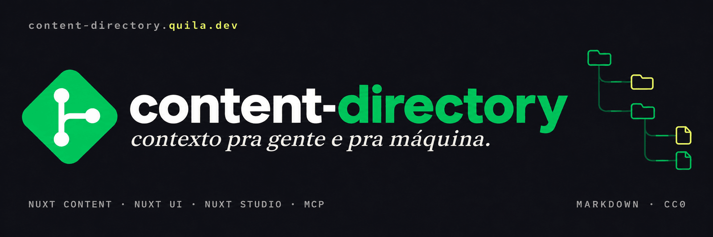

[](https://content-directory.quila.dev)

# Content Directory

Base de conhecimento pessoal sobre engenharia web: acessibilidade, performance, sustentabilidade, UX engineering, product discovery, qualidade e DX. Os posts são autorais, com fontes referenciadas, e ficam em Markdown no diretório `content/`.

O site é feito com [Nuxt Content](https://content.nuxt.com) e [Nuxt UI](https://ui.nuxt.com), e expõe o conteúdo para assistentes de IA por um servidor MCP em `/mcp`.

O escopo e os próximos passos estão no [PRD](./docs/PRD.md).

## Desenvolvimento

```bash
pnpm install
pnpm dev      # http://localhost:3000
pnpm build
pnpm preview
```

## Licença

- **Código** (aplicação Nuxt, configuração e componentes): [MIT](./LICENSE-CODE). Baseado no [Nuxt Docs Template](https://github.com/nuxt-ui-templates/docs).
- **Conteúdo** (textos autorais em `content/`): [CC0 1.0](./LICENSE). Domínio público: você pode copiar e adaptar sem pedir permissão e sem obrigação de dar crédito.
- **Material de terceiros** citado ou reproduzido nos posts permanece sob a licença da fonte original, indicada junto ao material.
